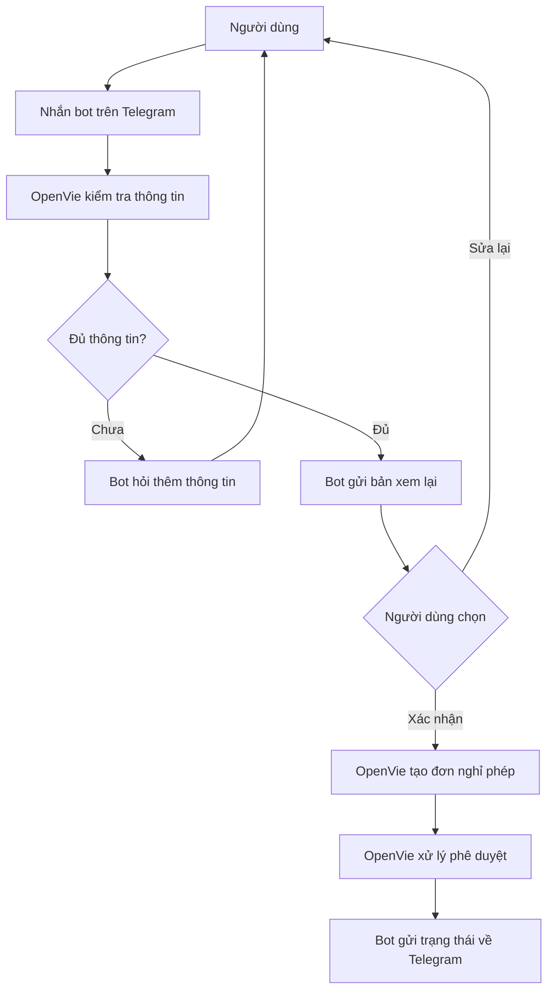
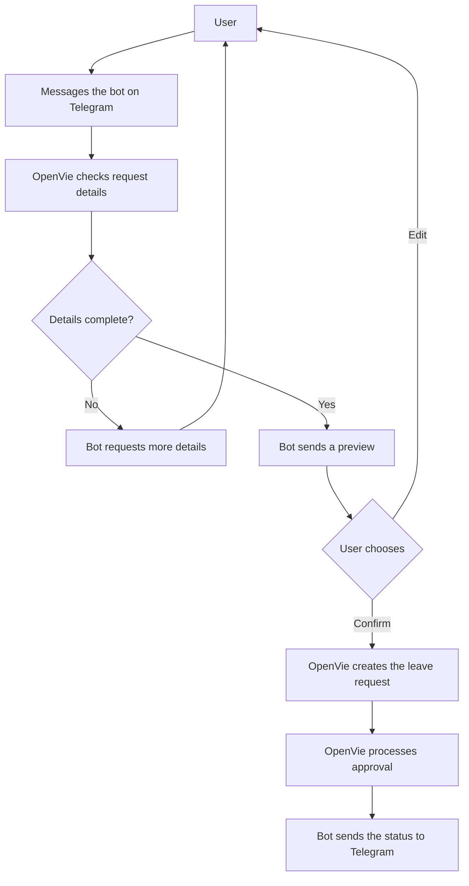

<a id="top"></a>

# OpenVie Leave Bot

Submit and track leave requests from Telegram, powered by OpenVie.

[Tiếng Việt](#tieng-viet) · [English](#english)

---

<a id="tieng-viet"></a>

## Tiếng Việt

OpenVie Leave Bot giúp bạn gửi và theo dõi đơn nghỉ phép ngay trong Telegram.
### Hướng dẫn sử dụng

Mở chat với bot trên Telegram rồi gửi `/start`. Bạn có thể bắt đầu bằng `/leave` hoặc nhắn như bình thường, ví dụ:

> Tôi muốn xin nghỉ từ 20/11 đến 21/11.

Bot sẽ hỏi thêm nếu thiếu thông tin và gửi lại bản xem trước khi tạo đơn. Kiểm tra kỹ rồi chọn **Xác nhận gửi đơn**. Nếu cần đổi thông tin, chọn **Sửa lại** và nhắn phần cần chỉnh.

| Lệnh | Dùng khi |
| --- | --- |
| `/leave` | Muốn bắt đầu một đơn nghỉ phép |
| `/status` | Muốn xem trạng thái các đơn đã gửi từ cuộc chat này |
| `/cancel` | Muốn hủy yêu cầu đang soạn, chưa gửi |

Khi đơn được duyệt hoặc từ chối trên OpenVie, bot sẽ nhắn kết quả vào Telegram.

### Giới thiệu nhanh

Đây là bot Telegram kết nối với OpenVie để tạo và theo dõi đơn nghỉ phép. Chỉ cần cấu hình token, API key rồi chạy bot bằng Node.js — bot dùng long polling nên không cần webhook hay URL public.

### Cài đặt và chạy

Bạn cần Node.js 20 trở lên, một Telegram Bot Token từ [@BotFather](https://t.me/BotFather), và OpenVie API key có quyền tạo leave request.

```bash
git clone <repository-url>
cd <source-directory>
cp .env.example .env
```

Điền token và thông tin OpenVie vào `.env`:

```env
TELEGRAM_BOT_TOKEN=123456:replace-this
OPENVIE_API_KEY=ovk_replace_this
OPENVIE_BASE_URL=https://openvie.example.com
OPENVIE_APP_KIND=leave-requests
OPENVIE_ENTITY=leave_requests
POLL_INTERVAL_MS=5000
```

Kiểm tra và chạy bot:

```bash
npm run check
npm start
```

Bot không có package dependency, nên không cần `npm install`. Để dừng bot, nhấn `Ctrl+C` trong terminal đang chạy.

### Cấu hình

| Biến | Ý nghĩa |
| --- | --- |
| `TELEGRAM_BOT_TOKEN` | Token do BotFather cấp |
| `OPENVIE_API_KEY` | API key của workspace OpenVie |
| `OPENVIE_BASE_URL` | URL gốc của OpenVie |
| `OPENVIE_APP_KIND` | App kind của leave request |
| `OPENVIE_ENTITY` | Entity lưu leave request |
| `POLL_INTERVAL_MS` | Chu kỳ kiểm tra trạng thái đơn, tối thiểu 1000 ms |

### Bảo mật và dữ liệu

`.env` chứa token và API key. Bot cũng tạo ba file dữ liệu runtime: `submissions.json`, `chat-sessions.json` và `update-offset.json`. Những file này đã được đưa vào `.gitignore`; bot đặt quyền đọc/ghi cho owner (`0600`) khi tạo file.

Không commit hoặc gửi token, API key hay file trạng thái vào chat. Nếu một token từng xuất hiện trong Git, hãy thu hồi token đó và tạo token mới trước khi công khai repository.

### Luồng xử lý



### Giấy phép

Mã nguồn được phát hành theo giấy phép MIT. Bạn có thể sử dụng, chỉnh sửa và phân phối lại theo điều khoản trong [LICENSE](LICENSE).

[Lên đầu trang](#top)

---

<a id="english"></a>

## English

OpenVie Leave Bot lets you submit and track leave requests directly in Telegram. OpenVie handles the request workflow; Telegram is simply a more convenient place to communicate.

### How to use

Open a chat with the bot in Telegram and send `/start`. Start with `/leave`, or just send a message such as:

> I would like to request leave from 20 November to 21 November.

The bot asks for any missing details and sends a preview before creating a request. Review it carefully, then select **Xác nhận gửi đơn**. To change something, select **Sửa lại** and send the correction.

| Command | Use when |
| --- | --- |
| `/leave` | Starting a leave request |
| `/status` | Checking requests sent from this chat |
| `/cancel` | Cancelling an unsubmitted request |

When a request is approved or rejected in OpenVie, the bot sends the result to Telegram.

### Quick overview

This is a Telegram bot that connects to OpenVie to create and track leave requests. Configure the token and API key, then run it with Node.js. The bot uses long polling, so it does not need a webhook or public URL.

### Setup and run

You need Node.js 20 or later, a Telegram Bot Token from [@BotFather](https://t.me/BotFather), and an OpenVie API key allowed to create leave requests.

```bash
git clone <repository-url>
cd <source-directory>
cp .env.example .env
```

Fill in `.env` with your token and OpenVie details:

```env
TELEGRAM_BOT_TOKEN=123456:replace-this
OPENVIE_API_KEY=ovk_replace_this
OPENVIE_BASE_URL=https://openvie.example.com
OPENVIE_APP_KIND=leave-requests
OPENVIE_ENTITY=leave_requests
POLL_INTERVAL_MS=5000
```

Check and run the bot:

```bash
npm run check
npm start
```

The bot has no package dependencies, so `npm install` is not required. To stop it, press `Ctrl+C` in the running terminal.

### Configuration

| Variable | Purpose |
| --- | --- |
| `TELEGRAM_BOT_TOKEN` | Token issued by BotFather |
| `OPENVIE_API_KEY` | API key for the OpenVie workspace |
| `OPENVIE_BASE_URL` | Base URL of OpenVie |
| `OPENVIE_APP_KIND` | App kind for leave requests |
| `OPENVIE_ENTITY` | Entity that stores leave requests |
| `POLL_INTERVAL_MS` | Request-status polling interval, at least 1000 ms |

### Security and data

`.env` contains tokens and API keys. The bot also creates three runtime data files: `submissions.json`, `chat-sessions.json`, and `update-offset.json`. They are listed in `.gitignore`, and the bot sets owner-only permissions (`0600`) when it creates them.

Do not commit or share tokens, API keys, or state files in chat. If a token has appeared in Git, revoke it and create a new one before making the repository public.

### Request flow



### License

This project is released under the MIT License. You may use, modify, and redistribute it under the terms in [LICENSE](LICENSE).

[Back to top](#top)
